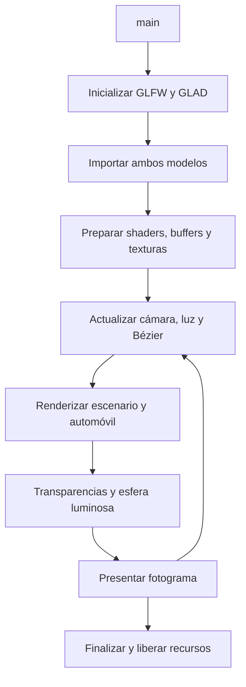
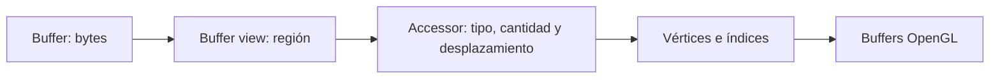

[README.md](https://github.com/user-attachments/files/35375327/README.md)
# Aston Martin One-77 — OpenGL, Phong y Bézier


## Índice

1. [Objetivos y arquitectura](#1-objetivos-y-arquitectura)
2. [Bibliotecas y ejecución](#2-bibliotecas-y-ejecución)
3. [Función main](#3-función-main)
4. [Importación glTF](#4-importación-gltf)
5. [Vértices y buffers](#5-vértices-y-buffers)
6. [Texturas](#6-texturas)
7. [Shaders](#7-shaders)
8. [Transformaciones y nodos](#8-transformaciones-y-nodos)
9. [Iluminación Phong](#9-iluminación-phong)
10. [Bézier compuesta](#10-bézier-compuesta)
11. [Orientación del automóvil](#11-orientación-del-automóvil)
12. [Tiempo y animación](#12-tiempo-y-animación)
13. [Cámara libre](#13-cámara-libre)
14. [Fuente luminosa](#14-fuente-luminosa)
15. [Renderizado de ambos modelos](#15-renderizado-de-ambos-modelos)
16. [Transparencias](#16-transparencias)
17. [Ciclo de renderizado](#17-ciclo-de-renderizado)
18. [Liberación de recursos](#18-liberación-de-recursos)
19. [Controles](#19-controles)
20. [Preguntas de sustentación](#20-preguntas-de-sustentación)
21. [Limitaciones y créditos](#21-limitaciones-y-créditos)

## 1. Objetivos y arquitectura

- Importar el automóvil y el escenario en formato glTF con sus texturas.
- Implementar iluminación ambiental, difusa y especular mediante Phong.
- Animar el automóvil mediante una curva de Bézier tridimensional compuesta.
- Permitir la exploración de la escena y el desplazamiento de la luz.



La geometría del automóvil y de la carretera no se genera mediante código: se importa. La esfera luminosa y la trayectoria sí se construyen matemáticamente.

## 2. Bibliotecas y ejecución

| Biblioteca | Función |
|---|---|
| OpenGL | API de renderizado tridimensional |
| GLFW | Ventana, contexto, tiempo y entradas |
| GLAD | Carga de funciones de OpenGL |
| GLM | Vectores, matrices y cuaterniones |
| TinyGLTF v3 | Lectura de archivos glTF y sus buffers |
| stb_image | Decodificación de imágenes |

Estructura esperada de los recursos:

```text
OpenGL1/
├── main.cpp
├── OpenGL1.vcxproj
├── libraries/
│   ├── include/
│   └── lib/
├── tiny_gltf_v3.h
├── tiny_gltf_v3.c
├── tinygltf_json_c.h
├── stb_image.h
└── modelo/
    ├── 2011_aston_martin_one-77/
    │   ├── scene.gltf
    │   ├── scene.bin
    │   └── textures/
    └── escenario/
        ├── scene.gltf
        ├── scene.bin
        └── textures/
```

En Visual Studio 2022, seleccionar Debug x64 y el conjunto de herramientas v143 si está instalado. Configurar las rutas relativas de inclusión y bibliotecas (`$(ProjectDir)libraries\include` y `$(ProjectDir)libraries\lib`), conservar las rutas heredadas y establecer el directorio de trabajo en `$(ProjectDir)`. El vinculador debe encontrar `glfw3.lib` para x64 y `opengl32.lib`; la implementación de GLAD debe formar parte del proyecto. Las rutas deben ajustarse a la ubicación real de los archivos.

TinyGLTF se implementa en `main.cpp` mediante `TINYGLTF3_IMPLEMENTATION`; no se debe compilar `tiny_gltf_v3.c` por separado en esta configuración. stb_image también se implementa en el archivo principal con `STB_IMAGE_STATIC` y `STB_IMAGE_IMPLEMENTATION`.

## 3. Función main

`main()` es el punto de entrada y coordina cuatro etapas: inicialización, carga, ejecución y finalización.

```cpp
if(!glfwInit()){std::cerr<<"No se pudo iniciar GLFW\n";return 1;}
glfwWindowHint(GLFW_CONTEXT_VERSION_MAJOR,3);
glfwWindowHint(GLFW_CONTEXT_VERSION_MINOR,3);
glfwWindowHint(GLFW_OPENGL_PROFILE,GLFW_OPENGL_CORE_PROFILE);
```

Se solicita OpenGL 3.3 Core y se crea una ventana de 1000 × 700. `glfwMakeContextCurrent()` activa el contexto y `gladLoadGLLoader()` carga las funciones disponibles. `glfwSwapInterval(1)` solicita sincronización vertical.

```cpp
glEnable(GL_DEPTH_TEST);glDisable(GL_CULL_FACE);
```

La prueba de profundidad permite que las superficies cercanas oculten a las lejanas. El descarte de caras se desactiva inicialmente y posteriormente se ajusta según cada material.

Se registran callbacks para el ratón y el tamaño del framebuffer. Después se importan los modelos, se preparan los shaders, se generan los recursos GPU y se entra en el bucle principal.

## 4. Importación glTF

El archivo `scene.gltf` describe nodos, mallas, materiales y referencias; `scene.bin` contiene datos binarios; `textures/` contiene imágenes.

```cpp
tg3_model scene = {}, nieve = {};
```

`tg3_parse_file()` interpreta los archivos. Los modelos se cargan al inicio, no en cada fotograma.

| Función | Responsabilidad |
|---|---|
| `attributeIndex()` | Busca atributos como POSITION, NORMAL y TEXCOORD_0 |
| `accessorData()` | Calcula la dirección de un elemento binario y comprueba límites |
| `readFloats()` | Lee atributos con componentes float |
| `readIndex()` | Lee índices de 8, 16 o 32 bits sin signo |
| `uploadScene()` | Prepara geometría y texturas del modelo activo |



`accessorData()` considera el desplazamiento del buffer view, el del accessor y el stride (separación entre elementos):

```cpp
uint64_t stride=bv.byte_stride?bv.byte_stride:bytes;
uint64_t offset=bv.byte_offset+a.byte_offset+uint64_t(index)*stride;
```

El importador está adaptado a estos modelos: procesa primitivas triangulares y atributos float, no todas las variantes posibles de glTF.

## 5. Vértices y buffers

```cpp
struct Vertex {glm::vec3 pos,normal;glm::vec2 uv;};
```

Cada vértice contiene posición XYZ, normal XYZ y coordenadas UV. La posición ubica el punto; la normal indica la orientación de la superficie; UV relaciona la geometría con una imagen.

| Recurso | Función |
|---|---|
| VAO | Conserva la configuración de atributos y la asociación con el EBO |
| VBO | Almacena los datos de vértices |
| EBO | Almacena los índices para reutilizar vértices |

```cpp
glBindBuffer(GL_ARRAY_BUFFER,g.vbo);
glBufferData(GL_ARRAY_BUFFER,verts.size()*sizeof(Vertex),verts.data(),GL_STATIC_DRAW);
glBindBuffer(GL_ELEMENT_ARRAY_BUFFER,g.ebo);
glBufferData(GL_ELEMENT_ARRAY_BUFFER,idx.size()*sizeof(unsigned int),idx.data(),GL_STATIC_DRAW);
```

`glVertexAttribPointer()` describe cómo interpretar cada atributo: ubicación 0 para posición, 1 para normal y 2 para UV. `offsetof()` obtiene el desplazamiento de cada campo dentro de la estructura. `GL_STATIC_DRAW` indica que los datos se cargarán principalmente una vez y se utilizarán repetidamente.

Un cuadrado puede representarse con cuatro vértices y seis índices: `0,1,2,0,2,3`. El EBO evita duplicar los vértices compartidos. El dibujo se realiza mediante:

```cpp
glDrawElements(g.mode,g.count,GL_UNSIGNED_INT,0);
```

## 6. Texturas

`uploadScene()` contempla 21 imágenes del automóvil y 29 del escenario. Las rutas están definidas explícitamente para estos recursos.

```cpp
unsigned char* datos=stbi_load(ruta.c_str(),&ancho,&alto,&canales,4);
```

El último argumento solicita cuatro canales RGBA. Si la carga falla, se informa en consola y se continúa con las demás imágenes.

```cpp
glTexImage2D(GL_TEXTURE_2D,0,GL_RGBA8,ancho,alto,0,GL_RGBA,GL_UNSIGNED_BYTE,datos);
glGenerateMipmap(GL_TEXTURE_2D);
stbi_image_free(datos);
```

Los píxeles se transfieren a OpenGL y se generan mipmaps, versiones de menor resolución que reducen el aliasing a distancia. Se utiliza filtrado lineal y trilineal para minificación, además de repetición de coordenadas UV. La memoria de la imagen en CPU se libera después de la transferencia.

Una textura es una imagen; un material reúne propiedades como color, rugosidad, transparencia y referencias a texturas. Aunque se cargan imágenes de normales y metallic-roughness, el shader emplea las texturas de color base y las normales geométricas, no normal mapping ni PBR completo.

## 7. Shaders

Los shaders son programas GLSL 330 ejecutados en la GPU.

| Shader | Función |
|---|---|
| `sceneVS` | Transforma los vértices y sus normales |
| `sceneFS` | Calcula color, textura, transparencia e iluminación |
| `lightVS` | Transforma los vértices de la esfera |
| `lightFS` | Muestra el color de la fuente luminosa |

### Vertex shader

```glsl
vec4 world = model * vec4(aPos,1.0);
FragPos = world.xyz;
Normal = mat3(transpose(inverse(model))) * aNormal;
TexCoord = aUV;
gl_Position = proj * view * world;
```

La posición se transforma al espacio mundial y luego al espacio de recorte. La matriz inversa transpuesta permite transformar correctamente las normales, incluso ante escalas no uniformes. Los atributos de salida se interpolan durante la rasterización.

### Fragment shader

```glsl
vec4 base = baseColorFactor;
```

Si existe textura, se muestrea mediante `texture(baseTexture,TexCoord)`. El RGB de la textura se convierte de sRGB a espacio lineal antes de calcular la luz. Al final se convierte nuevamente a sRGB y se limita el color al intervalo válido.

```glsl
FragColor = vec4(clamp(color,0.0,1.0),base.a);
```

### Compilación y comunicación

`compileShader()` crea y compila un shader; `makeProgram()` enlaza el vertex shader y fragment shader. Ambas funciones consultan el estado e imprimen errores si ocurren.

Una variable `uniform` recibe información desde C++ y permanece uniforme durante una llamada de dibujo. Por ejemplo:

```cpp
glUniform3fv(glGetUniformLocation(sceneProgram,"lightPos"),1,glm::value_ptr(lightPos));
```

## 8. Transformaciones y nodos

| Matriz | Función |
|---|---|
| Model | Posición, rotación y escala del objeto |
| View | Transformación respecto a la cámara |
| Projection | Perspectiva y volumen visible |

$$P_{clip}=Projection\times View\times Model\times P_{local}$$

`nodeTransform()` utiliza la matriz del nodo si existe; en caso contrario construye la transformación con traslación, rotación mediante cuaternión y escala (T × R × S).

`drawNode()` recorre recursivamente los nodos y combina las transformaciones:

```cpp
const auto& n=scene.nodes[nodeIndex];glm::mat4 world=parent*nodeTransform(n);
```

Los hijos heredan la transformación del padre, de modo que carrocería, ruedas e interior se desplazan conjuntamente.

`limitesNodo()` calcula límites espaciales recorriendo la jerarquía y transformando las ocho esquinas de las cajas locales de cada primitiva. A partir de estos límites se ajusta el tamaño del automóvil:

```cpp
glm::vec3 dimensiones=maximo-minimo;
float largo=std::max(dimensiones.x,dimensiones.z);
float escala=4.5f/largo;
glm::vec3 centro((minimo.x+maximo.x)/2,minimo.y,(minimo.z+maximo.z)/2);
glm::mat4 ajuste=glm::scale(glm::mat4(1),glm::vec3(escala))*glm::translate(glm::mat4(1),-centro);
```

La mayor dimensión horizontal queda en 4.5 unidades y el origen del automóvil se sitúa en el centro de su base. Esto facilita colocarlo sobre el pavimento.

## 9. Iluminación Phong

Phong aproxima la iluminación mediante tres componentes: ambiental, difusa y especular. Se calcula por fragmento.

```glsl
vec3 n = normalize(Normal);
if(!gl_FrontFacing) n = -n;
vec3 l = normalize(lightPos-FragPos);
vec3 v = normalize(viewPos-FragPos);
vec3 r = reflect(-l,n);
```

| Vector | Significado |
|---|---|
| N | Normal de la superficie |
| L | Dirección desde el fragmento hacia la luz |
| V | Dirección desde el fragmento hacia la cámara |
| R | Dirección de reflexión de la luz |

Normalizar produce vectores unitarios. El producto punto entre ellos representa el coseno del ángulo. `reflect(-l,n)` refleja el vector incidente respecto a la normal.

### 9.1. Ambiental

```glsl
float ambient = 0.06;
vec3 luzAmbiente = ambient * base.rgb;
```

Aporta un nivel mínimo de iluminación incluso cuando una superficie no mira hacia la luz. El factor 0.06 favorece el ambiente nocturno. No representa iluminación indirecta físicamente simulada.

### 9.2. Difusa

```glsl
float diffuse = max(dot(n,l),0.0);
```

$$D=\max(N\cdot L,0)$$

| Ángulo entre N y L | Factor difuso |
|---:|---:|
| 0° | 1 |
| 45° | 0.707 |
| 60° | 0.5 |
| 90° | 0 |
| Mayor de 90° | 0 |

`max()` evita contribuciones negativas cuando la superficie mira en sentido contrario a la luz.

### 9.3. Especular

```glsl
float specular = pow(max(dot(v,r),0.0),32.0) * brillo * step(0.0,diffuse-0.0001);
```

El reflejo depende de la cámara. El exponente 32 controla su concentración: un exponente mayor produce un reflejo más estrecho. `brillo` ajusta su amplitud según el material. `step()` evita el reflejo cuando la contribución difusa es prácticamente nula.

En `drawMesh()` se aprovechan los factores de rugosidad y metalicidad de glTF para ajustar el brillo de Phong. Esto es una aproximación artística, no un modelo PBR.

### 9.4. Atenuación

```glsl
float distancia = length(lightPos - FragPos);
float atenuacion = 1.0 / (1.0 + 0.035 * distancia + 0.008 * distancia * distancia);
```

$$A(d)=\frac{1}{1+0.035d+0.008d^2}$$

| Distancia | Factor aproximado |
|---:|---:|
| 0 | 1.000 |
| 5 | 0.727 |
| 10 | 0.465 |
| 20 | 0.204 |
| 30 | 0.108 |
| 50 | 0.044 |

La intensidad disminuye progresivamente con la distancia. No existe un radio de corte fijo.

### 9.5. Combinación final

```glsl
float intensidad = 3.5;
vec3 luzDifusa = diffuse * base.rgb * lightColor * intensidad;
vec3 luzEspecular = specular * lightColor * intensidad;
vec3 color = luzAmbiente + (luzDifusa + luzEspecular) * atenuacion;
```

$$C=C_a+(C_d+C_s)A(d)$$

| Parámetro | Valor |
|---|---|
| Ambiental | 0.06 |
| Exponente especular | 32 |
| Intensidad puntual | 3.5 |
| Atenuación constante, lineal, cuadrática | 1, 0.035, 0.008 |
| Color de la luz | (1.0, 0.94, 0.84) |

La componente ambiental no se atenúa. La luz es puntual y no se calculan sombras proyectadas.

## 10. Bézier compuesta

Una Bézier cúbica tiene cuatro puntos de control. P0 y P3 son sus extremos; P1 y P2 controlan la forma y las tangentes inicial y final.

$$B(v)=(1-v)^3P_0+3(1-v)^2vP_1+3(1-v)v^2P_2+v^3P_3$$

Cuando v=0 se obtiene P0; cuando v=1 se obtiene P3. La curva no tiene que pasar por los controles internos.

### 10.1. Ruta tridimensional

```cpp
const glm::vec3 origen(320,-15,-280);
const glm::vec3 ruta[] = {
 {289,-8.9f,-284.5f},{300,-10.2f,-286.5f},{316,-12.5f,-290},
 {328,-14.5f,-293.7f},{336,-15.6f,-292.8f},{340.3f,-16,-288.7f},
 {342.4f,-16.1f,-283.4f},{340,-16,-277.2f},{332,-15.9f,-271.9f},
 {320,-16.3f,-269},{305,-17.2f,-265},{294,-18,-261.9f}
};
const int N=sizeof(ruta)/sizeof(ruta[0]);
```

Los 12 puntos de ruta forman 11 segmentos cúbicos. X y Z describen el recorrido horizontal; Y permite seguir los desniveles. La ruta no se obtiene automáticamente en tiempo de ejecución: sus coordenadas están definidas en el código.

### 10.2. Selección del segmento

```cpp
float x = glm::clamp(t, 0.f, 1.f) * (N - 1);
int i = std::min(int(x), N - 2);
float v = x - i;
float u = 1.f - v;
```

`t` es el progreso global; `i` es el índice del segmento y `v` su progreso local. Por ejemplo, t=0.5 produce x=5.5, i=5 y v=0.5: la mitad del sexto segmento. `clamp()` y `min()` evitan índices fuera del arreglo.

### 10.3. Controles internos y continuidad

```cpp
glm::vec3 a = ruta[i], d = ruta[i+1];
glm::vec3 b = a + (d - ruta[std::max(0,i-1)]) / 6.f;
glm::vec3 c = d - (ruta[std::min(N-1,i+2)] - a) / 6.f;
```

Los extremos a y d son puntos de ruta consecutivos. Los controles b y c se calculan con los vecinos mediante una conversión de tangentes de tipo Catmull-Rom a Bézier. El factor 1/6 resulta de estimar la tangente mediante la diferencia de vecinos dividida entre dos y dividirla nuevamente entre tres, por la derivada de la Bézier cúbica.

En una unión interior, la derivada final del segmento anterior y la inicial del siguiente coinciden: ambas son la mitad de la diferencia entre los puntos de ruta vecinos. Así se obtiene continuidad de primera derivada en las uniones internas.

### 10.4. Evaluación

```cpp
return u*u*u*a + 3*u*u*v*b + 3*u*v*v*c + v*v*v*d - origen;
```

Se aplica la fórmula cúbica. Se resta `origen` porque el escenario también se traslada mediante `glm::translate(glm::mat4(1),-origen)`. Si solo se trasladara uno de ellos, la ruta dejaría de coincidir con la carretera.

## 11. Orientación del automóvil

```cpp
glm::vec3 tangente(float t){
 return bezier(std::min(1.f,t+.001f)) - bezier(std::max(0.f,t-.001f));
}
```

La diferencia entre dos posiciones cercanas aproxima la dirección tangente. No es necesario dividir por el intervalo para obtener los ángulos, porque solo interesa la dirección.

```cpp
glm::vec3 posicion=bezier(t)+glm::vec3(0,0.10f,0);
glm::vec3 direccion=tangente(t);
float angulo=std::atan2(direccion.x,direccion.z)+glm::radians(CAR_YAW_OFFSET);
glm::mat4 modelo=glm::translate(glm::mat4(1),posicion);
modelo=glm::rotate(modelo,angulo,glm::vec3(0,1,0));
float inclinacion=std::atan2(direccion.y,glm::length(glm::vec2(direccion.x,direccion.z)));
modelo=glm::rotate(modelo,-inclinacion,glm::vec3(1,0,0))*ajuste;
```

El margen vertical de 0.10 unidades ayuda a separar el automóvil del pavimento. Yaw es la rotación alrededor de Y para seguir las curvas. Pitch es la inclinación alrededor de X local para seguir las pendientes. `atan2()` considera los signos de ambas componentes y determina el cuadrante correcto. `CAR_YAW_OFFSET` vale 0 en esta versión y permite corregir la orientación original del modelo si fuera necesario.

## 12. Tiempo y animación

```cpp
float now=static_cast<float>(glfwGetTime()),dt=std::min(now-lastFrame,0.1f);lastFrame=now;
tiempoAnimacion+=dt;
float t=std::fmod(tiempoAnimacion/24.0f,1.0f);
```

Delta time representa el tiempo transcurrido entre fotogramas, limitado a 0.1 segundos para evitar saltos excesivos. El parámetro t avanza de 0 a 1 durante 24 segundos de tiempo de animación y `fmod()` lo reinicia.

| Tiempo de animación | t |
|---:|---:|
| 0 s | 0 |
| 6 s | 0.25 |
| 12 s | 0.5 |
| 18 s | 0.75 |
| 24 s | 0 |

La curva es abierta: al terminar, el automóvil vuelve directamente al inicio. La velocidad espacial no es constante porque los segmentos tienen distintas longitudes y el parámetro no está definido por longitud de arco. Si hay fotogramas muy lentos, el límite de dt puede alargar el recorrido en tiempo real.

## 13. Cámara libre

```cpp
glm::vec3 cameraPos(5.0f,24.0f,35.0f),cameraFront(0.0f,-0.574f,-0.819f),cameraUp(0,1,0);
```

`cameraPos` es la posición, `cameraFront` la dirección frontal y `cameraUp` la referencia vertical. El vector lateral se calcula con el producto cruz:

```cpp
glm::vec3 right=glm::normalize(glm::cross(cameraFront,cameraUp));
```

W y S desplazan la cámara hacia delante y atrás; A y D utilizan el vector lateral. La velocidad base es `6.0f*dt` y Shift izquierdo la duplica.

`mouseCallback()` actualiza yaw y pitch según el desplazamiento del ratón:

```cpp
yaw+=dx*0.1f;pitch+=dy*0.1f;pitch=glm::clamp(pitch,-89.0f,89.0f);
```

Se emplean seno y coseno para reconstruir el vector frontal. Limitar pitch evita que el vector frontal sea paralelo al vertical de referencia, lo que haría degenerar el cálculo lateral.

```cpp
glm::mat4 view=glm::lookAt(cameraPos,cameraPos+cameraFront,cameraUp);
glm::mat4 proj=glm::perspective(glm::radians(60.0f),float(fbw)/float(std::max(fbh,1)),0.3f,1800.0f);
```

La proyección utiliza un campo visual vertical de 60 grados, la relación de aspecto del framebuffer y planos de recorte a 0.3 y 1800 unidades. `framebufferCallback()` actualiza el viewport cuando cambia el tamaño de la ventana.

## 14. Fuente luminosa

```cpp
glm::vec3 lightPos(15.0f,5.0f,-8.0f),lightColor(1.0f,0.94f,0.84f);
```

La luz tiene una posición inicial y un color cálido. Su velocidad de desplazamiento es `8.0f*dt`. Las flechas modifican X/Z y Q/E modifican Y.

`createSphere()` construye una esfera unitaria con 16 divisiones verticales y 24 horizontales:

```cpp
verts.emplace_back(std::sin(phi)*std::cos(theta),std::cos(phi),std::sin(phi)*std::sin(theta));
```

Los vértices se conectan mediante índices triangulares. La esfera se traslada a `lightPos` y se escala a un radio de 0.35 unidades.

```cpp
glm::mat4 sphereModel=glm::scale(glm::translate(glm::mat4(1.0f),lightPos),glm::vec3(0.35f));
```

La esfera no emite luz físicamente: es un indicador visual. La iluminación real del programa se calcula en `sceneFS` usando `lightPos` y `lightColor`. Su shader independiente muestra el color directamente, sin aplicar Phong.

## 15. Renderizado de ambos modelos

```cpp
void cambiarModelo(){
 std::swap(scene,nieve);gpuMeshes.swap(mallasNieve);gpuTextures.swap(texturasNieve);esNieve=!esNieve;
}
```

Esta función intercambia las estructuras activas para reutilizar `uploadScene()`, `drawNode()` y `drawMesh()`. No vuelve a leer los archivos ni copia los buffers GPU en cada fotograma. `esNieve` indica qué conjunto está activo.

El escenario usa una transformación fija; el automóvil utiliza una matriz actualizada con Bézier. `drawMesh()` selecciona el material, configura el color base, brillo, textura y transparencia, y realiza el dibujo indexado. Se omite el plano de niebla original del escenario y se aplican ajustes específicos al vidrio del automóvil y a un material del escenario.

## 16. Transparencias

| Modo glTF | Comportamiento |
|---|---|
| OPAQUE | Superficie opaca |
| MASK | Descarta fragmentos cuyo alfa está bajo un umbral |
| BLEND | Mezcla el fragmento con el color existente |

Las primitivas BLEND se almacenan en `transparentes` para dibujarlas después de las opacas. Se ordenan de lejos a cerca utilizando la distancia al cuadrado entre el centro aproximado de cada primitiva y la cámara.

```cpp
glEnable(GL_BLEND);glBlendFunc(GL_SRC_ALPHA,GL_ONE_MINUS_SRC_ALPHA);glDepthMask(GL_FALSE);
```

Se conserva la prueba de profundidad, pero se desactiva temporalmente su escritura. Después se restaura con `glDepthMask(GL_TRUE)` y se desactiva la mezcla. El ordenamiento por centros es aproximado y puede fallar con superficies transparentes que se intersectan.

## 17. Ciclo de renderizado

```cpp
while(!glfwWindowShouldClose(window)){
    // Actualización y renderizado de cada fotograma.
}
```

En cada iteración:

1. Se calcula dt y se procesan eventos.
2. Se actualizan la cámara y la fuente luminosa.
3. Se limpian los buffers de color y profundidad.
4. Se calculan las matrices de vista y proyección y se envían uniforms.
5. Se activa y dibuja el escenario.
6. Se calcula la posición y orientación del automóvil mediante Bézier.
7. Se dibuja el automóvil.
8. Se ordenan y dibujan las primitivas transparentes.
9. Se dibuja la esfera luminosa con su propio programa de shaders.
10. `glfwSwapBuffers()` presenta el fotograma.

El fondo oscuro se define con `glClearColor(0.025f,0.035f,0.08f,1.0f)`. El doble buffer permite construir el siguiente fotograma antes de mostrarlo.

## 18. Liberación de recursos

Al cerrar la ventana se eliminan los VAO, VBO, EBO, texturas y programas de shaders de ambos modelos y de la esfera. `tg3_model_free()` libera los datos de TinyGLTF.

```cpp
tg3_model_free(&nieve);tg3_model_free(&scene);
glfwDestroyWindow(window);glfwTerminate();return 0;
```

La liberación evita mantener recursos innecesarios. La ruta normal de cierre realiza esta limpieza; algunas salidas tempranas por error no ejecutan toda la limpieza final.

## 19. Controles

| Entrada | Acción |
|---|---|
| W / S | Avanzar / retroceder |
| A / D | Desplazamiento lateral |
| Ratón | Orientar cámara |
| Shift izquierdo | Duplicar velocidad de cámara |
| Flechas izquierda / derecha | Mover luz en X |
| Flechas arriba / abajo | Mover luz en Z |
| Q / E | Subir / bajar luz |
| Esc | Liberar cursor |
| Clic izquierdo | Capturar cursor |

## 20. Preguntas de sustentación

<details><summary>¿Qué hace main()?</summary>

Inicializa OpenGL, carga los modelos y shaders, coordina la actualización y renderizado de cada fotograma y libera recursos al finalizar.

</details>
<details><summary>¿Cuál es la diferencia entre GLFW y GLAD?</summary>

GLFW administra la ventana, el contexto y las entradas. GLAD carga las funciones de OpenGL.

</details>
<details><summary>¿Qué diferencia existe entre VAO, VBO y EBO?</summary>

El VAO guarda la configuración de atributos; el VBO almacena los vértices y el EBO los índices.

</details>
<details><summary>¿Qué son las normales y las UV?</summary>

Las normales describen la orientación de la superficie y las UV indican cómo muestrear la textura.

</details>
<details><summary>¿Qué hace uploadScene()?</summary>

Lee los atributos e índices del modelo activo, crea los buffers de OpenGL y carga sus texturas.

</details>
<details><summary>¿Qué diferencia existe entre vertex shader y fragment shader?</summary>

El primero transforma vértices; el segundo calcula el color de los fragmentos rasterizados.

</details>
<details><summary>¿Qué es un uniform?</summary>

Un parámetro enviado desde C++ que permanece uniforme durante una llamada de dibujo, como la posición de la luz.

</details>
<details><summary>¿Por qué se usa la inversa transpuesta para las normales?</summary>

Para conservar su orientación perpendicular respecto a la superficie transformada, incluso con escalas no uniformes.

</details>
<details><summary>¿Cuáles son las componentes de Phong?</summary>

Ambiental: luz mínima. Difusa: depende del ángulo entre normal y luz. Especular: depende también de la dirección hacia la cámara.

</details>
<details><summary>¿Por qué normalizar los vectores?</summary>

Para que su longitud sea uno y el producto punto represente el coseno del ángulo entre ellos.

</details>
<details><summary>¿Por qué usar max en el cálculo difuso?</summary>

Para impedir contribuciones negativas cuando la superficie está orientada en sentido contrario a la luz.

</details>
<details><summary>¿Qué ocurre si se aumenta el exponente especular?</summary>

El reflejo se concentra en una región más estrecha; su intensidad máxima no aumenta necesariamente.

</details>
<details><summary>¿Para qué sirve la atenuación?</summary>

Reduce la contribución difusa y especular con la distancia a la fuente puntual.

</details>
<details><summary>¿La esfera ilumina por sí misma?</summary>

No. Solo representa visualmente la posición de la luz; el fragment shader calcula la iluminación.

</details>
<details><summary>¿Por qué usar Bézier compuesta?</summary>

Permite ajustar la trayectoria a las curvas y desniveles mediante 11 segmentos cúbicos conectados y 12 puntos de ruta.

</details>
<details><summary>¿La Bézier pasa por todos sus puntos de control?</summary>

No necesariamente. Cada segmento pasa por sus extremos; los controles internos determinan su forma.

</details>
<details><summary>¿Por qué se divide entre seis al calcular los controles?</summary>

La tangente estimada mediante vecinos tiene un factor 1/2 y la derivada de Bézier cúbica introduce un factor 3. Al convertir a controles se obtiene 1/6.

</details>
<details><summary>¿Qué hace tangente()?</summary>

Resta dos posiciones cercanas para aproximar la dirección del recorrido. Se utiliza para calcular yaw y pitch.

</details>
<details><summary>¿Por qué restar origen?</summary>

Para trasladar la trayectoria al mismo sistema de coordenadas que el escenario.

</details>
<details><summary>¿Cómo se aumenta la velocidad del automóvil?</summary>

Reduciendo el divisor 24.0f del cálculo de t. Por ejemplo, 12 reduce a la mitad la duración de la animación.

</details>
<details><summary>¿La velocidad es constante? ¿La curva es cerrada?</summary>

No. El parámetro avanza uniformemente pero no la distancia recorrida. La curva es abierta y al terminar se reinicia desde el comienzo.

</details>
<details><summary>¿Para qué sirve delta time?</summary>

Hace que el desplazamiento dependa del tiempo transcurrido y no directamente de la cantidad de fotogramas. El límite de 0.1 evita saltos excesivos.

</details>
<details><summary>¿Qué hace cambiarModelo()?</summary>

Intercambia los conjuntos de datos activos del escenario y el automóvil para reutilizar las funciones de carga y dibujo sin recargar los archivos.

</details>
<details><summary>¿Por qué usar recursividad en drawNode()?</summary>

Para recorrer la jerarquía de nodos y combinar la transformación de cada hijo con la de su padre.

</details>
<details><summary>¿Por qué dibujar las transparencias después?</summary>

Porque su color se mezcla con lo ya dibujado. Se ordenan aproximadamente de lejos a cerca y se desactiva temporalmente la escritura de profundidad.

</details>
<details><summary>¿Qué partes fueron importadas y cuáles programadas?</summary>

El automóvil y el escenario se importaron desde Sketchfab. Se programaron la lectura, preparación y renderizado de sus datos, los shaders, la iluminación, la trayectoria, la cámara y la esfera luminosa.

</details>
<details><summary>¿Se implementaron sombras, colisiones o físicas?</summary>

No. El proyecto utiliza iluminación Phong sin sombras proyectadas y movimiento paramétrico sin simulación física ni detección de colisiones.

</details>

## 21. Limitaciones y créditos

El proyecto integra importación glTF, texturizado, transformaciones, iluminación y animación paramétrica. No implementa PBR completo, normal mapping, sombras proyectadas, físicas, colisiones ni animación independiente de las ruedas. La ruta está ajustada específicamente a la carretera importada y no se adapta automáticamente a otros escenarios.

Recursos importados desde Sketchfab:

- Automóvil: 2011 Aston Martin One-77.
- Escenario: Snowy Mountain Road.

Los modelos y sus texturas pertenecen a sus respectivos autores. Consultar las licencias originales antes de redistribuir los recursos.

Proyecto académico de programación gráfica desarrollado en C++ y OpenGL.
